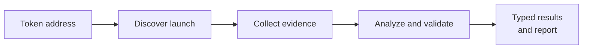
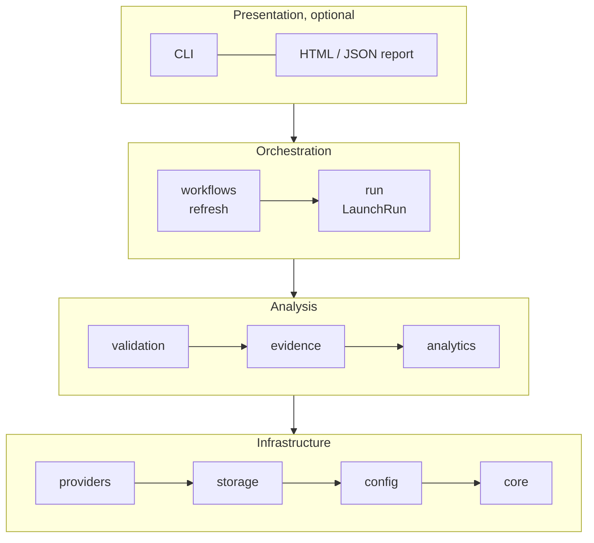

<p align="center">
  <a href="https://github.com/levkoldas/pons-analysis/actions/workflows/ci.yml"></a>
  <a href="LICENSE"></a>
  
  
</p>

# pons-analysis

**Typed, read-only Python library for PONS launch and wallet analysis on EVM chains.**

`pons-analysis` turns raw on-chain evidence into deterministic, validated
analysis: exact FIFO positions, fee attribution, holder and cohort behavior,
funding graphs, wallet clustering, and a self-contained HTML/JSON report.
Results are typed Python objects with optional Polars, pandas, Arrow, DuckDB,
NumPy, and NetworkX exports.

The library owns provider access, caching, evidence collection, accounting, and
validation. There is no database or server, and raw evidence remains
file-based.

> **Status: 0.1 (pre-1.0).** The public API is typed and tested, but minor
> releases may still adjust names or result schemas. Pin a version if you
> depend on exact output.

## Why this library

- **Evidence first.** Every analysis is derived from persisted logs, receipts,
  blocks, and provider responses. Analysis never rewrites raw evidence.
- **Exact accounting.** Token and wei amounts stay Python integers internally;
  tabular exports preserve raw amounts as decimal strings instead of silently
  casting through float or 64-bit columns.
- **One session object.** `LaunchRun` handles discovery, collection, analysis,
  validation, and optional persistence for a single token launch.
- **Bring your own stack.** Results are mapping-like summaries plus immutable
  `Table` objects that convert to Polars, pandas, Arrow, DuckDB, NumPy, Parquet,
  or NetworkX.
- **Offline-friendly.** Provider responses are SHA-256 addressed under
  `cache/`; `cache="offline"` raises `CacheMiss` rather than inventing data.
- **Layered by contract.** An import-linter contract keeps presentation,
  analytics, providers, and core from collapsing into each other.

## How it works



1. **Discover** the deployment block, pool identity, migration cut, or bonding
   curve state.
2. **Collect** a bounded launch snapshot, time window, descendants, and funding
   histories.
3. **Analyze** with engines that replay inventory, fees, flows, candles,
   cohorts, and wallet relationships.
4. **Validate** raw evidence and derived artifacts, then export the results that
   fit your workflow.

## Install

Requires **Python 3.12 or newer**. The package is distributed through GitHub,
not PyPI. The repository must be public for anonymous installs.

Install the latest `main`:

```bash
pip install "pons-analysis @ git+https://github.com/levkoldas/pons-analysis.git"
```

If the repository is private, authorized users can install over SSH instead:

```bash
pip install "pons-analysis @ git+ssh://git@github.com/levkoldas/pons-analysis.git"
```

Pin a tagged release:

```bash
pip install "pons-analysis @ git+https://github.com/levkoldas/pons-analysis.git@v0.1.0"
```

Install the optional integrations you need:

```bash
pip install "pons-analysis[all] @ git+https://github.com/levkoldas/pons-analysis.git"
```

Every tagged release also publishes a wheel. Install it directly from the
release asset, replacing the tag and filename with the version you want:

```bash
pip install https://github.com/levkoldas/pons-analysis/releases/download/v0.1.0/pons_analysis-0.1.0-py3-none-any.whl
```

| Extra | Contents |
| --- | --- |
| `frames` | NumPy, pandas, Polars, PyArrow |
| `sql` | DuckDB with PyArrow |
| `graph` | NetworkX |
| `cli` | Typer and Rich |
| `all` | every optional integration |
| `dev` | pytest, Hypothesis, mypy, ruff, import-linter, build |

The core install includes EVM decoding, HTTP, caching, Pydantic validation, and
every analysis engine. Public imports are lazy (module `__getattr__`, PEP 562):
importing `pons_analysis` does not load the provider or dataframe stack until a
name is used.

## Quick start

```python
from pons_analysis import Credentials, LaunchRun, RunConfig

with LaunchRun.discover(
    "0x2416a8bc9c617628a9105f6315f0c32e0a438860",
    workspace="./data",
    credentials=Credentials.from_env(),
    config=RunConfig(cache="online", persist=True),
) as run:
    run.collect_launch()
    run.collect_window(30)

    results = run.refresh(30)
    positions = results.positions
    print(positions.summary["totals"]["net_quote_eth"])
    print(positions.positions.to_polars().head())
```

Discovery resolves token metadata, deployment block, pool identity, and
migration automatically. It prefers the RPC; when the endpoint cannot
binary-search historical `eth_getCode`, it falls back to the Blockscout address
creation record. Without either source, pass `launch_start_block=...`
explicitly.

### Explicit launch

When the launch facts are already known, skip discovery:

```python
from pons_analysis import LaunchRun, MigrationCut, Pons, RunConfig

launch = Pons.launch(
    token="0x2416a8bc9c617628a9105f6315f0c32e0a438860",
    supply=10**27,
    start_block=56_007_631,
    start_timestamp=1_788_700_729,
    launch_start_block=56_007_476,
    migration=MigrationCut(block=56_007_631, tx_index=14, log_index=76),
    pool_id="0x077fcab0018a28dd0cc50ac1e62f224a0206252636cd4c419d6649a8c7806ea2",
)

with LaunchRun(launch, workspace="./data", config=RunConfig(persist=True)) as run:
    run.collect_launch()
    run.collect_window(30)
    result = run.positions(30)
```

`RunConfig.persist` defaults to `False`: analyses return in-memory results and
write only to a temporary overlay. Set `persist=True` to keep derived artifacts
under `analysis/`.

### Curve launches

A launch that is still trading on the bonding curve resolves with
`migration is None`:

```python
with LaunchRun.discover("0x579a...", workspace="./data") as run:
    print(run.launch.migrated)  # False
    run.collect_launch()
    run.collect_window(30)
    result = run.refresh(30)
    print(result.positions.summary["totals"]["net_quote_eth"])
```

Curve launches run through the same pipeline for curve trades, transfers,
holders, candles, flow, and FIFO positions. Remaining inventory is marked at the
last observed curve execution price. Once a launch graduates, rediscover it to
anchor analysis at the migration cut.

## Analyses

Every method returns a typed result. Mapping access reads through to
`.summary`; named properties expose the tables.

| Method | Result | Answers |
| --- | --- | --- |
| `launch_analysis()` | `LaunchResult` | Trades, wallet totals, holders, and route mix between deployment and the anchor |
| `window(minutes)` | `WindowResult` | Rotations, direct transfers, cohort holdings, five-minute summary |
| `positions(minutes)` | `PositionsResult` | Exact token inventory and FIFO quote PnL per wallet |
| `fees(minutes)` | `FeesResult` | Charged fees and taxes by phase, side, and wallet |
| `route_performance(minutes)` | `RoutePerformanceResult` | Wallet PnL joined to the route of its first launch buy |
| `entry_cohorts(minutes)` | `EntryCohortsResult` | First-activity buckets with exact performance |
| `retention(minutes)` | `RetentionResult` | Token and holder retention for entry-time cohorts |
| `lifecycle(minutes)` | `LifecycleResult` | Wallets grouped by entry phase and open/closed status |
| `trajectory(minutes)` | `TrajectoryResult` | Execution price, volume, and v4 virtual reserves |
| `candles(minutes)` | `CandlesResult` | OHLCV candles, VWAP, volatility, volume profile |
| `flow(minutes)` | `FlowResult` | Buy/sell order flow and wallet net flow |
| `holders(minutes)` | `HoldersResult` | Holder count, concentration, and HHI over time |
| `execution(minutes)` | `ExecutionResult` | v4 execution impact attributed to economic token wallets |
| `cohort(minutes, cohort=[...])` | `CohortResult` | Launch-to-exit generations, terminal holders, and PnL |
| `clusters(minutes)` | `ClustersResult` | Evidence-connected wallet clusters and round trips |
| `cluster_quality(minutes)` | `ClusterQualityResult` | Clusters joined to execution, fees, and lifecycle ROI |
| `funding()` | `FundingResult` | Native funding edges, fan-out hubs, and fresh-wallet rows |
| `provenance(minutes)` | `ProvenanceResult` | First native funding versus first-trade timing |
| `wallets(minutes)` | `WalletsResult` | Wallet scorecard joining PnL, fees, execution, flow, funding |
| `validate()` | `ValidationResult` | Raw launch, window, and funding consistency |
| `validate_derived(minutes)` | `ValidationResult` | Derived artifact consistency and source hashes |
| `compare(left, right)` | `ComparisonResult` | Deterministic comparison of two analyzed windows |
| `refresh(minutes)` | `RefreshResult` | Dependency-ordered full run plus both validation passes |

`RefreshResult` exposes named properties (`refresh.positions`,
`refresh.candles`, `refresh.validation`, …) and mapping-style lookup.

## Results and tables

```python
positions = run.positions(30)

positions.summary
positions.positions
positions.lots
positions.trade_legs
positions.transactions
```

`summary` is the mapping-like overview; the rest are `Table` objects.

`Table` is immutable and preserves exact Python integers. Convert it to the
stack you already use:

```python
table.to_dicts()
table.to_polars()
table.to_arrow()
table.to_pandas()
table.to_numpy()
table.to_duckdb()
table.to_networkx(source="source", target="destination")
table.to_parquet("positions.parquet")
```

```python
import polars as pl

df = run.positions(30).positions.to_polars()
ranked = df.filter(pl.col("roi_bps").is_not_null())
top = ranked.sort("roi_bps", descending=True).head(20)
```

```python
relation = run.positions(30).positions.to_duckdb()
relation.filter("roi_bps > 0").show()
```

Raw wei and token amounts are preserved as decimal strings in tabular exports.
`numpy.int64`, `numpy.uint64`, and Arrow `Int128` cannot represent the full EVM
`uint256` range, so the library never silently casts raw balances. Derived ETH
columns are floats; use Python integers or the string columns for exact
arithmetic.

## Evidence and workspace

Collection always writes raw evidence under the workspace. Analysis can remain
in memory or persist separately.

```python
run.collect_launch()
run.collect_window(30)
run.collect_successors(["0x..."], with_activity=True)
run.collect_funding(["0x...", "0x..."])
```

```text
data/
├── cache/
│   ├── rpc/                    # SHA-256-addressed RPC responses
│   ├── blockscout/             # Blockscout responses
│   └── gmgn/                   # GMGN responses
├── evidence/
│   ├── launch/                 # logs, receipts, blocks, transactions, record
│   ├── windows/<minutes>/      # bounded token, curve, and swap logs plus receipts
│   ├── successors/             # transfer graph and wallet activity
│   └── funding/wallets/<wallet>/
├── analysis/                   # derived artifacts when persist=True
└── manifest.json               # written by manifest()
```

Raw evidence is never rewritten during analysis. `collect_launch()` reads the
factory record at the chain head by default and records coverage through the
migration block, or through the head for a curve launch.

Offline mode consumes only matching cached responses:

```python
from pons_analysis import RunConfig

config = RunConfig(cache="offline")  # "online", "offline", or "refresh"
```

## CLI

The CLI is a thin adapter over the same library:

```bash
pip install "pons-analysis[cli] @ git+https://github.com/levkoldas/pons-analysis.git"
```

Collection, analysis, and reporting are separate commands, so a full run is:

```bash
pons-analysis --token 0x... --workspace ./data collect launch
pons-analysis --token 0x... --workspace ./data collect window 30
pons-analysis --token 0x... --workspace ./data analyze all 30
pons-analysis --token 0x... --workspace ./data report --minutes 30
```

Without explicit launch fields, each command calls `LaunchRun.discover` and
uses `Credentials.from_env()` or `--credentials-file`. Run
`pons-analysis --help` for the complete option set. Report output must stay
under `analysis/` and use the `.html` extension; the adjacent `.json` bundle is
written with it.

## Configuration and credentials

The library does not read environment variables or the current directory on
import. Callers construct configuration and credentials explicitly; the
optional CLI adds environment adapters (`PONS_TOKEN`, `PONS_WORKSPACE`,
`PONS_OFFLINE`).

```python
from pons_analysis import Credentials, RunConfig

credentials = Credentials.from_env()
credentials = Credentials.from_file("credentials.json")
credentials = Credentials(gmgn_api_key="...", blockscout_api_key="...")

config = RunConfig(
    cache="online",  # online | offline | refresh
    persist=False,
    timeout=30.0,
    retries=6,
    max_workers=8,
)
```

`Credentials` redacts keys in `repr`. GMGN read endpoints authenticate with
`gmgn_api_key` as `X-APIKEY` plus a fresh `timestamp` and `client_id` per
request. Non-2xx provider responses include the HTTP status and a bounded
response body, so account, Cloudflare, and archive-token failures stay visible.

## Validation

```python
raw = run.validate()
derived = run.validate_derived(30)

print(raw.passed, raw["checks"])
print(derived.passed, derived.summary["failures"])
```

`refresh()` runs raw validation and derived validation after every analysis.
`manifest()` writes SHA-256 hashes for every workspace artifact, so a result can
be tied back to exact input bytes.

## Architecture



Import direction points downward. The `import-linter` contract in
`pyproject.toml` enforces the layering, so `analytics` cannot reach into the
CLI and provider or store protocols stay in `ports.py`.

The deterministic report renderer is pure presentation: it reads existing
`analysis/` documents, embeds CSS and an inline SVG chart, and writes one
self-contained HTML file plus a stable JSON bundle and source hashes. It never
touches raw evidence or provider caches.

## Development

```bash
python -m venv .venv
.venv/bin/pip install -e '.[dev]'
make check PYTHON=.venv/bin/python
```

`make check` runs Ruff linting and formatting, mypy on the typed public API,
pytest, the import-linter architecture contract, and an import smoke test. CI
runs the same gate on Python 3.12, 3.13, and 3.14, then builds and validates the
sdist and wheel. Pushing a `v*` tag runs the release workflow and attaches those
artifacts to a GitHub Release.

## Contributing

See [CONTRIBUTING.md](CONTRIBUTING.md) for setup, the quality gate, and coding
guidelines. Security issues should follow [SECURITY.md](SECURITY.md).

## License

MIT. See [LICENSE](LICENSE).
